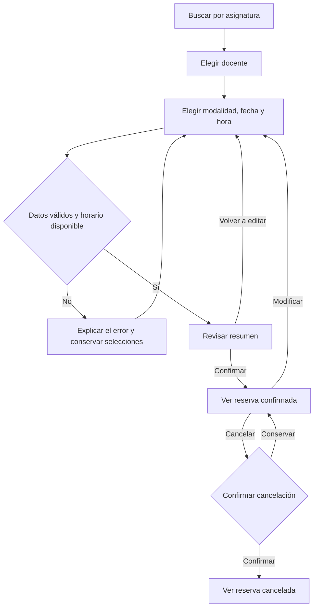

# Diseño de Tutoría UX

## Alcance y trazabilidad
Un estudiante gestiona su propia agenda desde un navegador. El catálogo usa tres docentes ficticios. Todas las tutorías se consideran del mismo bloque de duración.

| ID | Resultado esperado | Pantalla y componente | Comprobación concreta | Prueba o evidencia disponible |
|---|---|---|---|---|
| R1 | Encontrar docentes por nombre o asignatura, incluso sin tildes | Buscar tutoría · buscador y tarjetas | Abrir `/` y verificar 3 docentes visibles; buscar `interaccion` (sin tilde) y confirmar 1 resultado (`Elena Arias`); buscar `bases` y confirmar `Diego Vega`; ingresar un término inexistente (ej. `fisica`) y comprobar el aviso sin resultados. | [tests/interfaz.cjs](../tests/interfaz.cjs) (conteo de 3 docentes y filtro «bases»), [evidencias/despues/seleccion.png](../evidencias/despues/seleccion.png) y [evidencias/despues/escritorio.png](../evidencias/despues/escritorio.png) |
| R2 | Elegir modalidad, fecha futura u hoy y horario futuro | Reservar · formulario | Elegir a `Diego Vega`, seleccionar `Virtual` y `2099-05-06`, dejar `Horario` vacío y pulsar `Revisar reserva`: verificar alerta `Selecciona un horario.`, foco automático en `Horario` y conservación de modalidad y fecha; comprobar además el rechazo de fechas pasadas o inválidas y de horas pasadas del día actual. | [tests/reservas.test.js](../tests/reservas.test.js) (`rechazar campos inválidos y fechas pasadas`, `rechazar hora pasada del día actual`), [tests/interfaz.cjs](../tests/interfaz.cjs), [evidencias/despues/error-horario.png](../evidencias/despues/error-horario.png) y [ux/wireframes.html](../ux/wireframes.html) |
| R3 | Revisar y confirmar una reserva válida | Revisar · detalle y botón principal | Elegir `09:00`, ir a `Revisar reserva`, probar `Volver a editar` comprobando que conserva `09:00`, regresar al resumen y pulsar `Confirmar reserva`; recargar la página (`F5`) y confirmar que la reserva persiste en `Mis reservas` sin afectar `/ux/prototipo/`. | [tests/reservas.test.js](../tests/reservas.test.js) (`registrar y recuperar desde otra instancia`) y [tests/interfaz.cjs](../tests/interfaz.cjs) (retorno desde resumen, confirmación, recarga y aislamiento del prototipo) |
| R4 | Consultar reservas y distinguir estados | Mis reservas · tarjeta con estado textual | Abrir `Mis reservas` tras confirmar y tras cancelar una tutoría; verificar que cada tarjeta muestre el estado textual (`Confirmada` o `Cancelada`) junto a asignatura, docente, fecha, hora y modalidad, y que la tarjeta cancelada oculte las acciones de edición. | [tests/interfaz.cjs](../tests/interfaz.cjs) (lectura de tarjeta confirmada y estado `Cancelada`) y [evaluacion/inspeccion.md](../evaluacion/inspeccion.md) (heurística de visibilidad del estado) |
| R5 | Cambiar datos de una reserva activa sin duplicarla | Modificar · formulario precargado | Desde una tarjeta `Confirmada`, pulsar `Modificar`, verificar los valores precargados, cambiar el horario de `09:00` a `14:00`, revisar y pulsar `Guardar cambios`; comprobar que existe una sola tarjeta con la hora `14:00` y que un choque de horario conserva la reserva anterior. | [tests/reservas.test.js](../tests/reservas.test.js) (`editar conserva identidad y evita duplicados`, `un conflicto conserva la reserva anterior`) y [tests/interfaz.cjs](../tests/interfaz.cjs) |
| R6 | Cancelar previa confirmación o conservar la reserva | Cancelar · resumen y dos acciones | Pulsar `Cancelar`, verificar la pantalla `¿Cancelar esta tutoría?`, probar primero `Conservar reserva` comprobando que sigue `Confirmada`, y repetir con `Confirmar cancelación` verificando estado `Cancelada`, liberación del horario e imposibilidad de editarla. | [tests/reservas.test.js](../tests/reservas.test.js) (`cancelar libera el horario e impide editar la cancelada`) y [tests/interfaz.cjs](../tests/interfaz.cjs) (ambas decisiones) |

## Mapa del sitio
```text
Tutoría UX
├── Buscar tutoría
│   └── Reservar tutoría
│       └── Revisar y confirmar
└── Mis reservas
    ├── Modificar → Revisar y guardar
    └── Cancelar → Confirmar o conservar
```

## Flujo del estudiante


## Arquitectura
La presentación administra el borrador, los formularios, los mensajes y el foco. La capa de aplicación coordina el registro, la edición y la cancelación mediante un repositorio. El dominio valida el catálogo, las fechas y el cruce de horarios. Infraestructura serializa la lista como JSON y permite sustituir el almacenamiento en las pruebas. La aplicación definitiva usa localStorage y el prototipo usa sessionStorage. Enviar el formulario de revisión no escribe todavía en el repositorio. Confirmar ejecuta otra validación y persiste el resultado.
