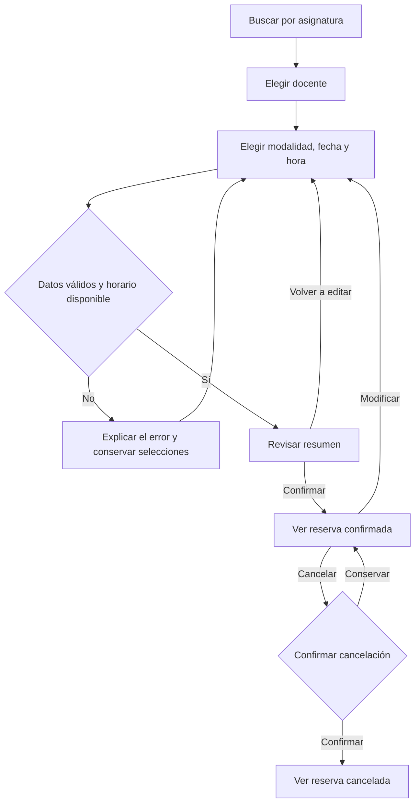

# Diseño de Tutoría UX

## Alcance y trazabilidad
Un estudiante gestiona su propia agenda desde un navegador. El catálogo usa tres docentes ficticios. Todas las tutorías se consideran del mismo bloque de duración.

| ID | Resultado esperado | Pantalla y componente | Verificación |
|---|---|---|---|
| R1 | Encontrar docentes por nombre o asignatura, incluso sin tildes | Buscar tutoría · buscador y tarjetas | Buscar «interaccion» y luego una cadena inexistente |
| R2 | Elegir modalidad, fecha futura u hoy y horario futuro | Reservar · formulario | Dejar la hora vacía, corregir y conservar el resto |
| R3 | Revisar y confirmar una reserva válida | Revisar · detalle y botón principal | Confirmar y recargar la página |
| R4 | Consultar reservas y distinguir estados | Mis reservas · tarjeta con estado textual | Ver Confirmada y Cancelada |
| R5 | Cambiar datos de una reserva activa sin duplicarla | Modificar · formulario precargado | Cambiar hora y comprobar una sola tarjeta |
| R6 | Cancelar previa confirmación o conservar la reserva | Cancelar · resumen y dos acciones | Probar ambas decisiones |

## Mapa del sitio
```text
Tutoría UX
├── Buscar tutoría
│   └── Reservar tutoría
│       └── Revisar y confirmar
└── Mis reservas
    ├── Modificar → Revisar y guardar
    └── Cancelar → Confirmar o conservar
```

## Flujo del estudiante


## Arquitectura
La presentación administra el borrador, los formularios, los mensajes y el foco. La capa de aplicación coordina el registro, la edición y la cancelación mediante un repositorio. El dominio valida el catálogo, las fechas y el cruce de horarios. Infraestructura serializa la lista como JSON y permite sustituir el almacenamiento en las pruebas. La aplicación definitiva usa localStorage y el prototipo usa sessionStorage. Enviar el formulario de revisión no escribe todavía en el repositorio. Confirmar ejecuta otra validación y persiste el resultado.
